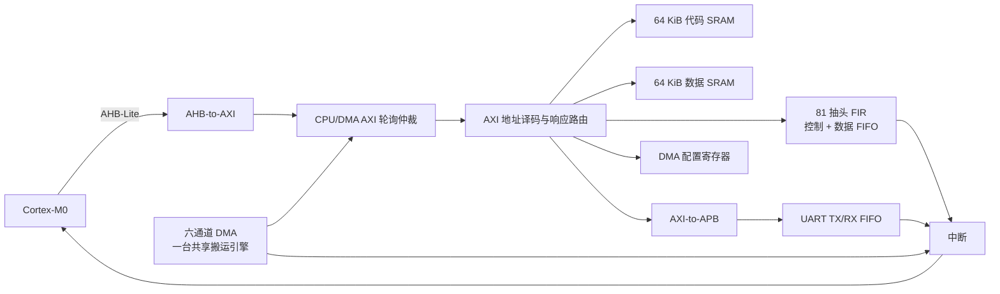

# Cortex-M0 + 81 阶 FIR SoC

这是面向 FPGA 芯片设计与应用竞赛整理的可移植源码包。它保留当前有效的 RTL、C 固件、地址映射、最终比赛验收 Testbench 和验收日志；学习阶段的旧模块测试、Vivado 缓存、波形数据库和自动生成工程目录均未打包。

## 当前状态

- 行为仿真最终回归：**11/11 PASS**，见 [验证报告](docs/VERIFICATION.md)。
- 已实现：Cortex-M0 接入、AHB-Lite 到 AXI、支持单拍与 INCR Burst 的 AXI SRAM、CPU/DMA 轮询仲裁、81 抽头 FIR、双 FIFO UART、AXI 到 APB、六通道可配置 DMA、DMA/FIR/UART/SRAM 综合固件与中断。
- 尚未完成：开发板专用 XDC、布局布线、板级时序收敛、位流下载和真实串口/引脚验证。
- 因而当前结论是“**仿真验收通过，可以进入上板阶段**”，不是“已经完成上板验收”。

## 系统结构



更详细的模块和数据流说明见 [系统架构](docs/ARCHITECTURE.md)。

## 主要比赛功能

| 要求 | 当前实现 |
|---|---|
| 32 位 Cortex-M0 | 已接入指定 Cortex-M0 DesignStart 接口；厂商 RTL 需由授权用户本地提供 |
| 81 阶可配置 FIR | 81 个 16 位系数、16 位输入、持续运行达到 1 sample/cycle |
| AXI 单拍与 Burst | 32 位 AXI 子集，单拍及最多 16 拍 INCR，含背压、LAST 和 4 KiB 检查 |
| AHB 到 AXI | CPU AHB-Lite 单次访问转换为 AXI 单拍 |
| AXI 到 APB | UART 外设访问转换为 APB 事务 |
| 片内存储 | 64 KiB 代码 SRAM + 64 KiB 数据 SRAM |
| 六通道 DMA | 六组独立配置/状态/中断，共享一台 Burst 搬运引擎，由调度器轮询执行 |
| UART | APB UART，TX/RX 各带 FIFO，支持 CPU 轮询和 DMA 请求 |
| 软件 | C 驱动、向量表、链接脚本、UART 回显和六通道综合场景固件 |

## 地址映射

| 地址范围 | 模块 |
|---|---|
| `0x0000_0000 - 0x0000_FFFF` | 代码 SRAM / 向量表 |
| `0x2000_0000 - 0x2000_FFFF` | 数据 SRAM |
| `0x4000_0000 - 0x4000_0FFF` | FIR 控制与系数 |
| `0x4000_1000 - 0x4000_1FFF` | FIR 输入/输出数据窗口 |
| `0x4000_4000 - 0x4000_4FFF` | UART0，经 AXI-to-APB |
| `0x4000_E000 - 0x4000_EFFF` | 六通道 DMA 配置和状态 |
| `0x4000_F000 - 0x4000_FFFF` | 系统测试/保留区域 |

硬件地址定义位于 `rtl/include/soc_addr_map.vh`，软件地址定义位于 `sw/include/soc_memory_map.h`。修改地址时必须同步更新两者。

## 目录

```text
rtl/                    可综合 RTL
  ahb_to_axi/           CPU AHB-Lite 到 AXI 桥
  axi_to_apb/           AXI 到 APB 桥
  cortex_m0/            CPU 封装；vendor/不包含受限厂商源码
  dma/                  六通道寄存器、调度器和搬运引擎
  fir/                  81 抽头 FIR 及 AXI 封装
  interconnect/         CPU/DMA 仲裁、地址译码和响应路由
  soc/                  SoC 顶层与时钟复位
  sram/                 SRAM 核心和 AXI Burst 从机
  uart/                 APB UART、FIFO 和串并转换
sw/                     C 驱动、应用、头文件和链接脚本
sim/                    仅保留最终 11 项比赛验收
constraints/            板级 XDC 模板
scripts/                创建 Vivado 工程、综合和实现脚本
verification/results/   2026-10-11 的 11/11 PASS 日志
docs/                   架构、验证、上板和第三方许可说明
```

## 工具要求

- Windows；
- Xilinx Vivado 2019.2；
- Arm GNU Toolchain，提供 `arm-none-eabi-gcc`、`objcopy` 和 `objdump`；
- 合法取得的 Cortex-M0 DesignStart RTL。

建议在 Vivado 命令行环境中运行。若工具不在 `PATH`，先设置：

```powershell
$env:VIVADO_BIN = 'E:\vivado2019\Vivado\2019.2\bin'
$env:ARM_GNU_BIN = 'E:\Tools\ArmGNU\15.3.rel1\bin'
$env:ARM_CORTEX_M0_RTL_DIR = 'E:\path\to\licensed\cortex_m0\verilog'
```

`ARM_CORTEX_M0_RTL_DIR` 目录中需要存在：

```text
CORTEXM0INTEGRATION.v
cortexm0ds_logic.v
```

也可以把这两个文件放入 `rtl/cortex_m0/vendor/`，但在公开上传前必须确认自己的 ARM 许可允许再分发。

## 运行最终比赛验收

```powershell
powershell -NoProfile -ExecutionPolicy Bypass -File .\sim\run_competition_acceptance.ps1
```

默认重新编译两份 Cortex-M0 固件。若只想使用仓库中已经生成的 `.hex`：

```powershell
$env:SKIP_FIRMWARE_BUILD = '1'
powershell -NoProfile -ExecutionPolicy Bypass -File .\sim\run_competition_acceptance.ps1
```

运行输出写入 `build/acceptance_logs/`。XSim 2019.2 在某些 `$fatal` 情况下可能仍返回 0，因此聚合脚本同时检查进程退出码和每个测试的 PASS 标志。

## 创建 Vivado 工程

```powershell
& "$env:VIVADO_BIN\vivado.bat" -mode batch -source scripts/create_vivado_project.tcl
```

默认器件为 `xc7a100tcsg324-1`。需要更换器件时：

```powershell
$env:FPGA_PART = '你的器件型号'
& "$env:VIVADO_BIN\vivado.bat" -mode batch -source scripts/create_vivado_project.tcl
```

生成的工程和所有中间产物位于 `build/`，不会污染源码目录，也不会提交 Git。

## 上板前必须完成

1. 确认开发板型号、FPGA 器件、晶振频率、复位极性、UART 和 LED 引脚。
2. 复制 `constraints/board_template.xdc` 为 `constraints/board.xdc` 并填写真实约束。
3. 根据真实时钟修正 UART 分频和时钟约束。
4. 运行综合、实现和生成位流，确认实现后时序至少满足 25 MHz。
5. 检查 SRAM 是否按预期推断为 BRAM；若 LUTRAM/寄存器过多，应调整 RAM 编码或添加适合目标器件的 RAM 属性。
6. 将最终固件初始化到代码存储器，或确定板上加载/调试方式。
7. 下载位流，依次验证复位、LED、UART 回显、FIR 和六通道 DMA 综合场景。

详细步骤见 [上板清单](docs/BOARD_BRINGUP.md)。

## 第三方源码和公开上传

本包未包含 ARM 标记为 confidential/proprietary 的 Cortex-M0 DesignStart 实现文件。不要在未确认许可的情况下把原工程中的 `CORTEXM0INTEGRATION.v`、`cortexm0ds_logic.v` 上传到公开 GitHub。详见 [第三方许可说明](docs/THIRD_PARTY.md)。

本仓库没有替你声明开源许可证。正式公开前，应由参赛团队确认自研 RTL/软件的版权归属并选择合适的 LICENSE。

## 上传到 GitHub

确认仓库公开性和第三方许可后，在本目录执行：

```powershell
git init
git add .
git commit -m "Initial competition release"
git branch -M main
git remote add origin https://github.com/<你的账号>/<仓库名>.git
git push -u origin main
```

第一次 `git add .` 后建议运行 `git status`，确认没有 ARM 厂商 RTL、`build/`、Vivado 缓存或本地绝对路径工程文件被加入。

